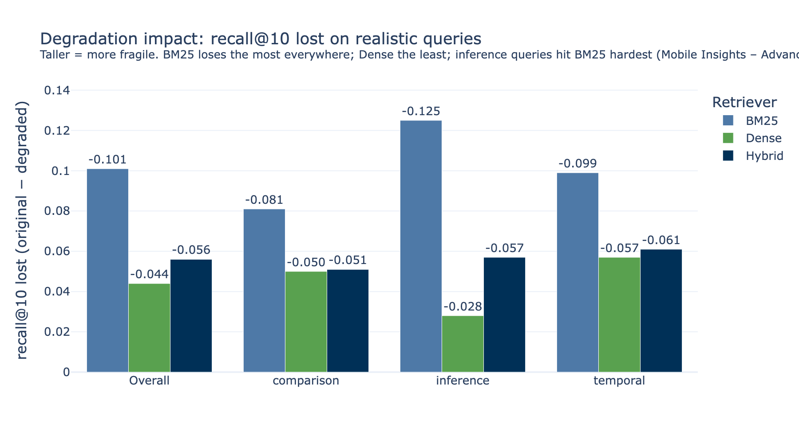
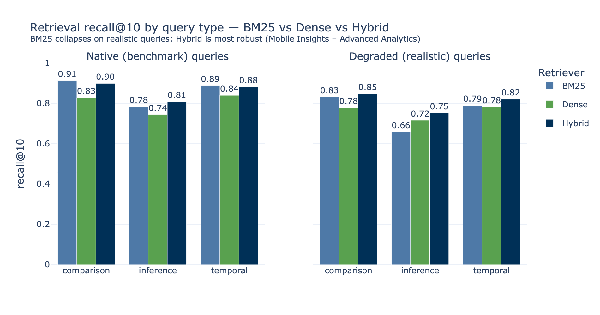

# RAG Architecture Eval

Comparing retrieval architectures (BM25 vs dense embeddings vs hybrid) on the
[MultiHopRAG](https://huggingface.co/datasets/yixuantt/MultiHopRAG) benchmark,
built on AWS (SageMaker Studio + Bedrock + Terraform).

*Mobile Insights – Advanced Analytics*

## The question

If you're building retrieval-augmented generation, do you need semantic
(embedding) retrieval, or is cheap keyword search (BM25) good enough? This
project builds the three main retrieval architectures and evaluates them
head-to-head — and finds that **the answer depends entirely on how realistic
your queries are**, in a way a naive benchmark run hides.

## Headline finding

On the benchmark's *native* queries, cheap **BM25 looks best** — which would
wrongly suggest "don't bother with embeddings." But those queries are
unrealistically keyword-rich: they were LLM-generated *from* the source
articles, so they share exact proper nouns, dates, and even the news outlet's
name with the answer passage. Real users don't phrase questions that way.

When we rewrite the queries to look like **real user questions** (shorter,
vaguer, no cited sources), BM25's advantage **collapses** while dense retrieval
barely moves — and **hybrid retrieval wins every question type**.

### Degradation impact — the key chart

How much recall@10 each retriever *loses* when queries become realistic. Taller
bar = more fragile.



- **BM25 loses the most everywhere** — 0.101 overall, 2.3× dense's 0.044.
- On **inference** (semantic-reasoning) queries the gap is ~4.5×: BM25 loses
  0.125, dense only 0.028.
- **Dense is the most robust** to vague phrasing; **hybrid** sits in between but
  starts highest.

### Absolute recall@10 by query type



## Results

### recall@10 — native vs degraded queries

| recall@10  | BM25  | Dense | Hybrid |
|------------|-------|-------|--------|
| native     | 0.859 | 0.801 | 0.862  |
| degraded   | 0.758 | 0.757 | **0.806** |
| drop       | −0.101 | −0.044 | −0.056 |

### recall@10 by question type — degraded (realistic) queries

| recall@10 (degraded) | BM25  | Dense | Hybrid |
|----------------------|-------|-------|--------|
| comparison           | 0.832 | 0.778 | **0.847** |
| inference            | 0.658 | 0.716 | **0.751** |
| temporal             | 0.789 | 0.782 | **0.821** |

Hybrid (reciprocal rank fusion of BM25 + dense) wins **every** question type on
realistic queries — on inference it beats *both* arms (fusion recovers what each
alone misses).

## Conclusion / recommendation

1. A naive leaderboard on this benchmark says "use BM25." That conclusion is an
   **artifact of unrealistically keyword-rich queries.**
2. Real user queries resemble the *degraded* set. There, **semantic retrieval
   earns its keep** and **hybrid dominates**.
3. **Recommendation: hybrid retrieval (BM25 + dense via RRF).** Best on native
   queries, most robust on realistic ones, wins every question type on the
   realistic set.

## Honest caveats

- Degraded queries are an **LLM-produced proxy** for real user traffic, not
  actual logs — directional evidence, not a production measurement.
- A first manipulation-check metric (fraction of query tokens found in the gold
  docs) was **length-confounded** and went the wrong way; it is *not* relied on.
  The direct retrieval deltas above are the ground truth.
- Single embedding model (Amazon Titan Text Embeddings V2), single benchmark
  (MultiHopRAG, news). A different corpus could shift the result — the harness
  is corpus-agnostic and ready to re-run.
- Retrieval eval only. End-to-end answer quality (generate + judge) is a
  separate, later evaluation.

## What's here

```text
src/rag_eval/            # retrieval harness (corpus-agnostic)
  retrievers/            #   bm25, dense (Titan+FAISS), hybrid (RRF)
  metrics.py             #   recall@k, all_hit@k, MRR@k, nDCG@k
  bedrock.py             #   cached Titan embeddings client
notebooks/               # SageMaker Studio lessons/runs
  data_processing.ipynb  #   chunk corpus -> S3; embed -> FAISS -> S3
  bm25_eval / dense_eval / hybrid_eval.ipynb
  query_degradation.ipynb#   generate the realistic-query set (Amazon Nova)
terraform/               # bootstrap (state + budget) + envs/dev (data bucket, SageMaker)
report/                  # the charts above + CSV
METHODOLOGY.md           # full method, decisions, results, reproduce steps
tests/                   # metric + retriever unit tests
```

## Reproduce

Infra: `terraform/bootstrap` (once), then `terraform/envs/dev`. Then in
SageMaker Studio run the notebooks in order (`data_processing` →
`query_degradation` → the three `*_eval` notebooks, toggling `USE_DEGRADED`).
Charts regenerate with `python scripts/make_report_chart.py`. Full detail in
[`METHODOLOGY.md`](METHODOLOGY.md).
